# SSH Brute-Force Detection Lab

## Abstract

I built this small-scale SOC lab to demonstrate how a SIEM detects a brute-force attack. I configured a target virtual machine running SSH to forward its authentication logs to Splunk, then built a scheduled search to flag any source IP generating an unusually high number of failed login attempts. I simulated a brute-force attack against the target using Hydra, verified the resulting logs in Splunk, and confirmed the detection rule triggered automatically — proving the full pipeline, from attack to logging to forwarding to automated detection, worked as intended.

## Objective

To build a small detection lab demonstrating how a SIEM is used to detect a brute-force attack. This involved setting up a target machine with SSH logging, forwarding its logs to Splunk, writing detection logic to flag repeated failed logins, and verifying the detection against a real Hydra brute-force attack.

## Lab Environment

| Component | Role | Details |
|---|---|---|
| Splunk Enterprise (Free) | SIEM | Installed natively on my Windows host |
| Kali Linux | Attacker | Existing VM, used to run Hydra |
| Ubuntu Server 22.04 | Target | New VM, running OpenSSH server only |
| VirtualBox Host-Only Network | Connectivity | Links host, Kali, and target on `192.168.56.0/24` |
| Splunk Universal Forwarder | Log shipper | Installed on the target, forwards `/var/log/auth.log` to Splunk |

**Addresses used:**
- Splunk (host): `192.168.56.1`
- Kali (attacker): `192.168.56.102`
- Target (SSH): `192.168.56.105`

I installed Splunk directly on my host rather than in its own VM to reduce resource usage, since my hardware was limited to 8GB of RAM.

## Procedure

### Step 1: Install and Configure Splunk

I downloaded and installed Splunk Enterprise (Free) on my Windows host using the standard installer. After installation, I enabled the receiving port so Splunk could accept data from other machines:

**Settings > Forwarding and receiving > Configure receiving > New Receiving Port > 9997**

> **[Screenshot: Splunk installed and logged in]**

### Step 2: Build the Target VM

I created a new VM in VirtualBox:
- OS: Ubuntu Server 22.04 LTS
- RAM: 2GB
- Network: one NAT adapter (internet access) and one Host-only adapter (lab network)

After installation, I installed OpenSSH server and created a test user:

```
sudo apt update && sudo apt install openssh-server
sudo adduser halcyon
```

I confirmed the SSH service was active and running:

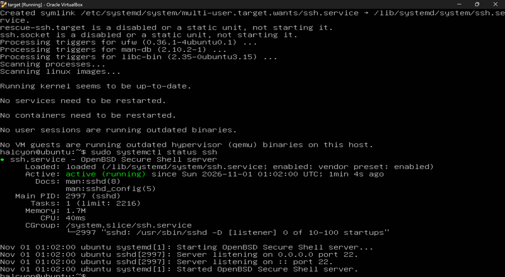

I confirmed the target's address on the lab network with `ip addr`:

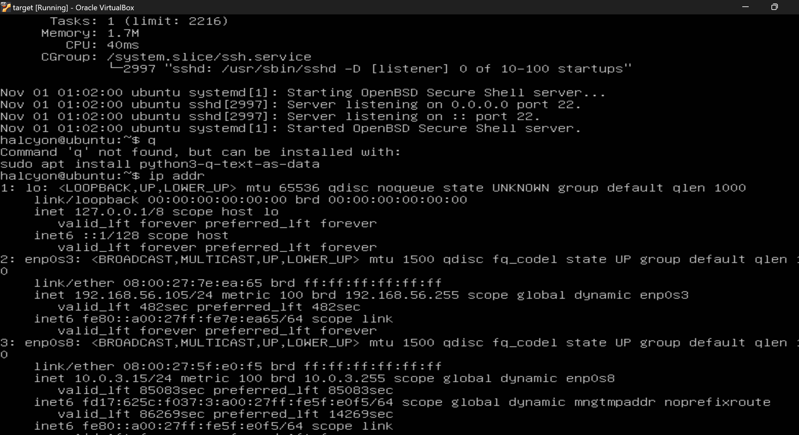

### Step 3: Forward Logs to Splunk

I installed the Splunk Universal Forwarder on the target VM to send its SSH log entries to Splunk:

```
sudo dpkg -i splunkforwarder-*.deb
cd /opt/splunkforwarder/bin
sudo ./splunk start --accept-license
sudo ./splunk add monitor /var/log/auth.log -auth <fwd-user>:<fwd-pass>
sudo ./splunk add forward-server 192.168.56.1:9997 -auth <fwd-user>:<fwd-pass>
```

I verified this by attempting an SSH login with an incorrect password and confirming the event appeared in Splunk:


### Step 4: Build the Detection Search

I used the following Splunk search (SPL) to detect brute-force activity:

```spl
index=* "Failed password"
| rex field=_raw "from (?<src_ip>\d+\.\d+\.\d+\.\d+)"
| stats count by src_ip
| where count > 10
```

**How it works:**
- `"Failed password"` filters for failed SSH login events
- `rex` extracts the source IP address from the raw log text (I needed this because Splunk hadn't auto-extracted `src_ip` as a field)
- `stats count by src_ip` counts failed attempts per source IP
- `where count > 10` flags any IP exceeding the threshold, treating it as a possible brute-force attempt

I tested the search with a single manual failed login before running the real attack, confirming the field extraction worked correctly:

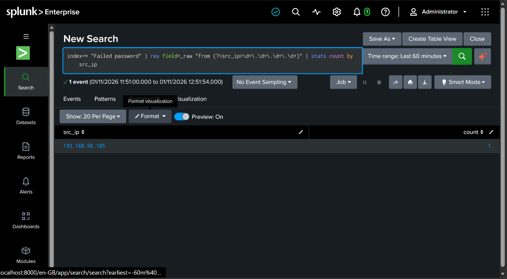

After the attack, running the same saved search showed the threshold being crossed, with 22 failed attempts counted from Kali's IP:

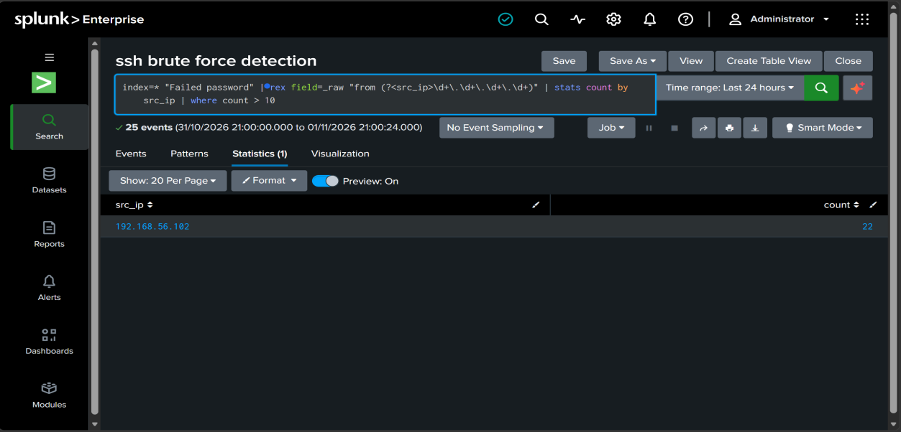

### Step 5: Configure the Alert

I saved the search above as a scheduled alert:
- **Type:** Scheduled
- **Schedule:** Cron `*/5 * * * *` (every 5 minutes)
- **Search window:** Last 60 minutes
- **Trigger condition:** Per-Result (fires when the search returns at least one row)
- **Trigger action:** Add to Triggered Alerts

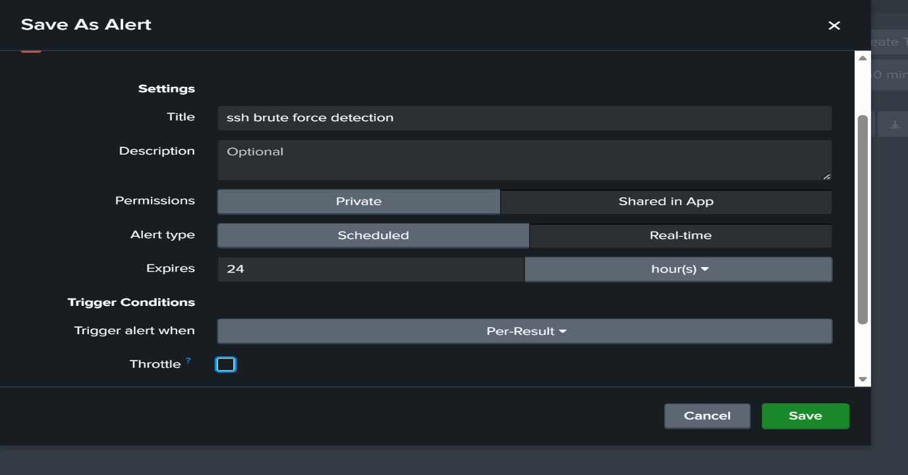

### Step 6: Simulate the Attack

Before launching the attack, I confirmed connectivity from Kali to the target with a ping test:

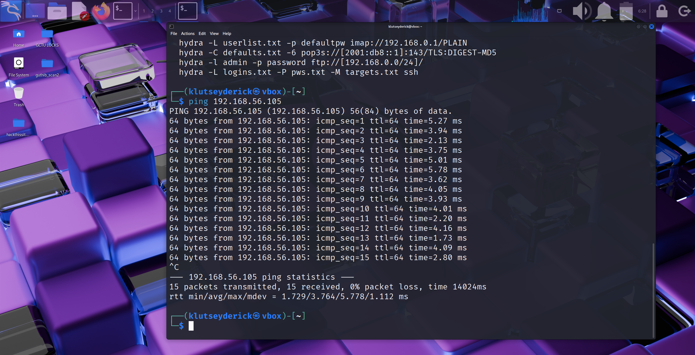

I confirmed Kali's address on the lab network (`192.168.56.102`) with `ifconfig`:

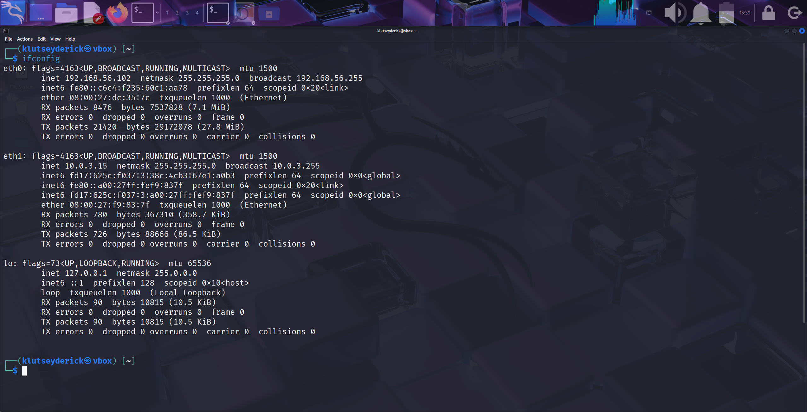

I created a wordlist of 15 passwords, placing the correct password partway through the list rather than at the start or end:

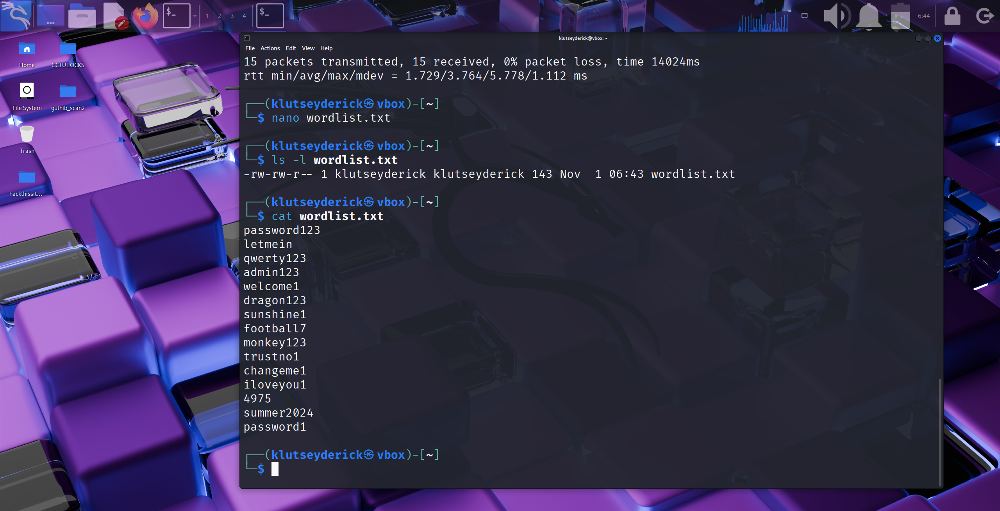

I then used Hydra to run a brute-force attack against the target's SSH service:

```
hydra -l halcyon -P wordlist.txt ssh://192.168.56.105
```

Hydra successfully identified the correct credentials:

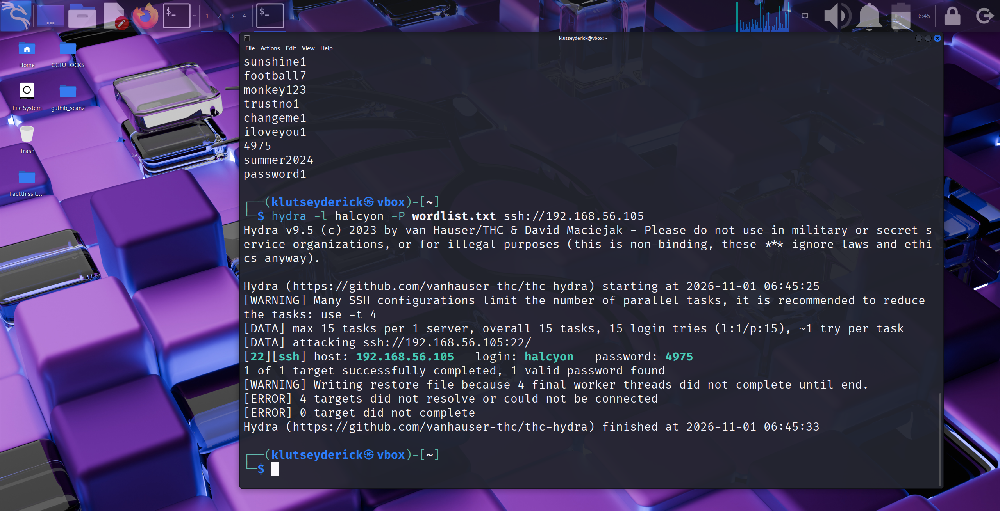

## Results

After the attack, I confirmed the raw events in Splunk:

```spl
index=* "Failed password"
```

This search returned all failed login attempts generated during the attack, originating from Kali's IP address (`192.168.56.102`):

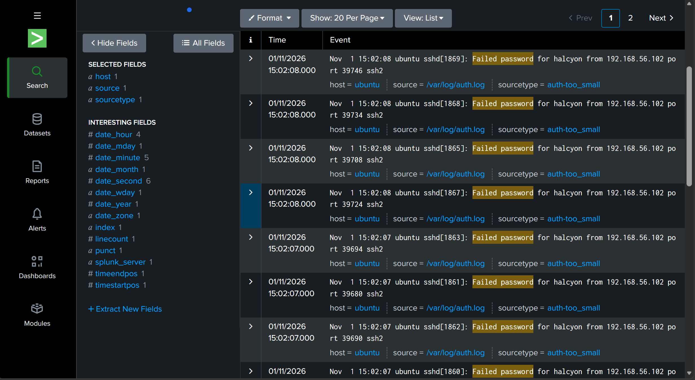

My saved alert triggered multiple times while the attack data remained within the 60-minute search window, confirming the detection fired automatically without any manual searching on my part:

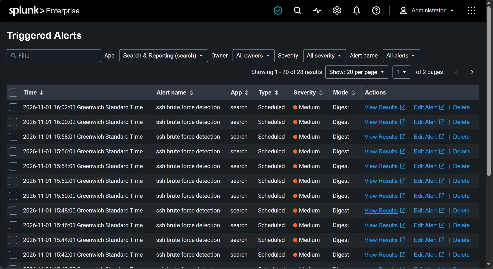

## Discussion

My results confirm that the detection pipeline functioned as designed: failed SSH attempts generated by Hydra were captured by the target's authentication log, shipped to Splunk by the forwarder, and correctly identified by my scheduled search once the failure count exceeded the defined threshold.

One notable finding was that Splunk did not automatically extract the source IP as a structured field, since it hadn't seen enough sample data to recognize the sourcetype. This meant my initial detection search returned no results even though the raw log events were present. Extracting the field manually using `rex` resolved this and taught me that field extraction can't always be assumed to work automatically — it depends on how well Splunk recognizes the log format.

This also showed me why validating each stage of a detection pipeline individually (log generation, forwarding, field extraction, and alerting) matters before assuming the overall detection logic is correct.

## Conclusion

This lab gave me a complete, working detection pipeline: a target generating authentication logs, a forwarder shipping those logs to a SIEM, and a scheduled detection rule that automatically identifies brute-force activity based on failed login volume. The exercise took me through log forwarding, SPL field extraction, alert configuration, and validation against a real simulated attack.
